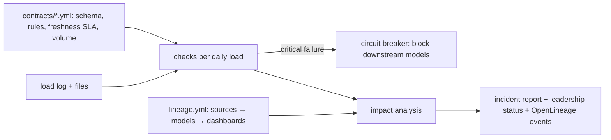

# Data Contracts & Observability

[](https://github.com/Saigwe/data-contracts-observability/actions/workflows/ci.yml)
 

> **Headline:** four upstream breakages on the same morning were **caught before reaching the board's revenue dashboard**. Bad data was blocked, owners were named and leadership got a plain-English status page, while a healthy dashboard kept running.

Source teams and the data team agree a **contract** for each dataset: its schema, quality rules, freshness SLA and normal volume. Every load is checked against it. When a contract breaks, lineage shows which models and dashboards are affected, a **circuit breaker** stops those models publishing, and two reports are written: one for engineers, one for leadership.

## What happened on the simulated morning

| Source | Incident (planted) | Detected as |
|---|---|---|
| `raw.payments` | Upstream renamed `amount_gbp` to `amount` | Schema: required column missing (critical) |
| `raw.orders` | Partial outage, 60% of rows missing | Volume: robust z = -10 against the last 14 loads |
| `raw.orders` | 6% of orders without a customer | Null rate above the 0.5% contract limit |
| `raw.customers` | Daily load did not run | Freshness: 26h old against a 24h SLA |

**Outputs:**
- **[`output/data_health_status.md`](output/data_health_status.md):** the leadership view. 3 of 4 reports on hold, the Support SLA dashboard still trusted, and confirmation that no incorrect figures were published.
- **[`output/incident_report.md`](output/incident_report.md):** the engineering view. Every failure with its owner, severity and first-response runbook step, the blast radius by dashboard tier, and a lineage diagram with affected nodes highlighted.
- **`output/openlineage_events.jsonl`:** one [OpenLineage](https://openlineage.io) run event per dataset with data-quality assertions, ready for Marquez, DataHub or Atlan.

## How it works



- **Contracts as code:** YAML in [`contracts/`](contracts), owned and reviewed through pull requests like any other code.
- **Robust volume baseline:** median and median absolute deviation over the last 14 loads, so one bad day can't distort what "normal" looks like.
- **Severity drives action:** critical failures block publishing; warnings (unexpected values, out-of-range numbers) alert but don't block.
- **Blast radius by tier:** tier-1 dashboards (CFO and Finance) are listed first, so the most important stakeholders are told first.

## Run it

```bash
pip install -r requirements.txt
python -m observability.run
pytest
```

## Stack

Python, YAML contracts, OpenLineage event format, Mermaid lineage, pytest.
