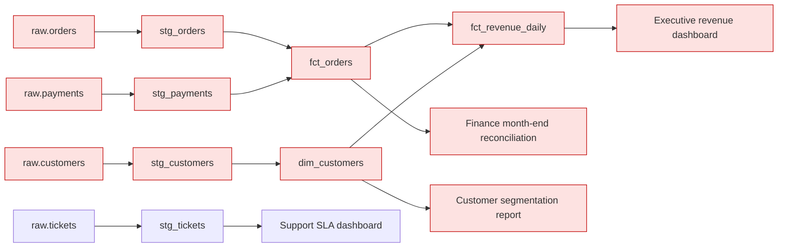

# Data incident report: 30 October 2026 05:00

**5 contract failures** across 3 sources. Publishing is **blocked** for 6 models: dim_customers, fct_orders, fct_revenue_daily, stg_customers, stg_orders, stg_payments.

| Source | Owner | Check | Severity | Detail | First response |
|---|---|---|---|---|---|
| raw.customers | crm-team | freshness | critical | newest load is 26h old (SLA 24h) | Check the ingestion job and upstream availability; rerun the load; tell consumers data is stale. |
| raw.orders | checkout-team | volume | critical | 825 rows vs typical 2,006 (robust z = -10.1, limit ±4) | Confirm with the owner whether this is a real drop or a partial load; hold publishing until known. |
| raw.orders | checkout-team | customer_id: null rate | critical | 6.4% nulls (contract allows 0.5%) | Quarantine rows with missing keys; ask the owner to fix the producer; backfill once fixed. |
| raw.payments | payments-platform | volume | critical | 613 rows vs typical 1,514 (robust z = -9.4, limit ±4) | Confirm with the owner whether this is a real drop or a partial load; hold publishing until known. |
| raw.payments | payments-platform | schema: expected columns present | critical | missing ['amount_gbp']; unexpected ['amount'] | Contact the source owner; pin the last good schema; add a mapping or agree a versioned change. |

## Blast radius

| Dashboard | Owner | Tier | Caused by |
|---|---|---|---|
| Executive revenue dashboard | CFO office | 1 | raw.customers, raw.orders, raw.payments |
| Finance month-end reconciliation | Finance | 1 | raw.orders, raw.payments |
| Customer segmentation report | Marketing | 2 | raw.customers |

## Lineage

